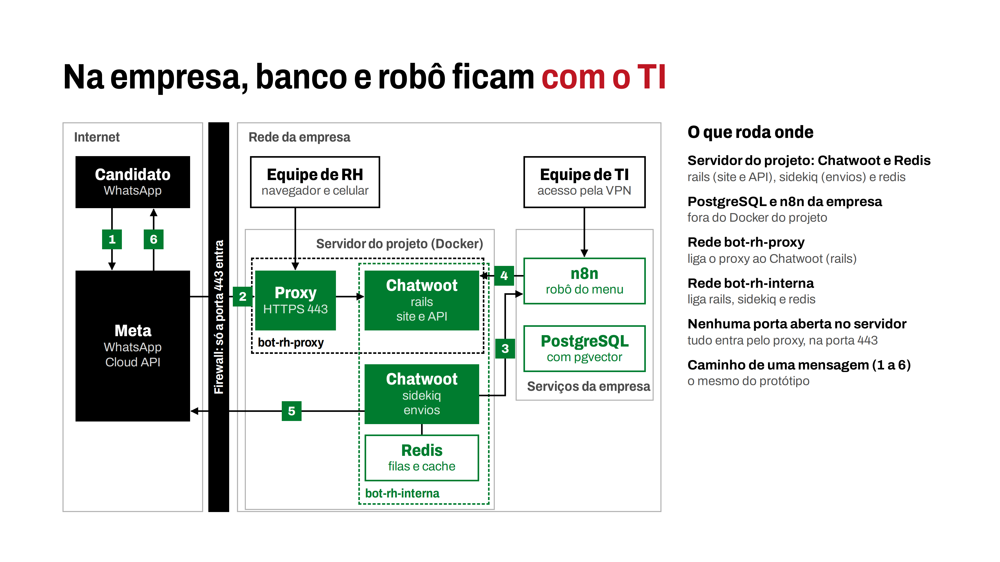

# Deploy do chatbot de RH na infraestrutura da empresa

Modelo de deploy definido com o TI em 25/11/2026. Em relação ao protótipo (pasta `chatwoot-proto/`):

- O servidor do projeto roda o **Chatwoot** (serviços `rails` e `sidekiq`) e o **Redis**.
- **PostgreSQL e n8n são serviços da empresa** e saíram do Docker do projeto.
- O compose cria **duas redes**: `bot-rh-interna` (containers do projeto) e `bot-rh-proxy` (ligação com o proxy reverso).
- Nenhuma porta é publicada no servidor: tudo entra pelo proxy, na porta 443.



## O que roda onde

| Onde | O quê |
|---|---|
| Servidor do projeto (este compose) | Chatwoot `rails` (site e API, porta 3000 interna), `sidekiq` (envios à Meta, eventos do robô, e-mails) e `redis` (filas e cache). Volumes `storage_data` (anexos, currículos) e `redis_data` (filas) |
| Serviços da empresa | PostgreSQL (com pgvector), n8n, proxy reverso com TLS, SMTP |
| Fora da empresa | Meta (WhatsApp Cloud API) |

## Redes

| Rede | Quem participa | Para quê |
|---|---|---|
| `bot-rh-interna` | `rails`, `sidekiq` e `redis` | Rede própria dos containers do projeto. O Redis só é alcançável por ela |
| `bot-rh-proxy` | `rails` (apelido `bot-rh-chatwoot`) e o proxy da empresa | O proxy encaminha `https://<domínio>` para `http://bot-rh-chatwoot:3000` |

O `sidekiq` não entra na rede do proxy: ele não recebe chamadas, só faz chamadas de saída.

## Pré-requisitos (TI)

**PostgreSQL**
- Extensões exigidas pelo Chatwoot 4.20.1: `vector` (pgvector), `pg_trgm`, `pgcrypto`, `pg_stat_statements` e `plpgsql`. **Sem o pgvector instalado no servidor, a preparação do banco falha.**
- Banco, usuário e extensões: [postgres/preparar-banco.sql](postgres/preparar-banco.sql). O protótipo foi validado com PostgreSQL 16.

**Proxy reverso**
- Domínio (ex.: `atendimento.EMPRESA.com.br`) com certificado TLS.
- Repassar WebSocket (`/cable`), usado nas atualizações em tempo real do painel.
- O caminho `/webhooks/whatsapp/...` precisa ficar acessível pela internet (a Meta chama por ele).

**Firewall**
- Entrada: 443 no proxy.
- Saída do servidor do projeto: HTTPS para `graph.facebook.com` (Meta) e `hub.2.chatwoot.com` (versão e notificações do app de celular), PostgreSQL, n8n e SMTP da empresa.

**Outros**
- SMTP corporativo (convites e redefinição de senha do RH).
- Meta: número real registrado na Cloud API, nome de exibição aprovado, token permanente de usuário do sistema, App Secret e webhook do app com o campo `messages` assinado.

## Passo a passo

1. `cp .env.example .env` e preencha. Todas as variáveis estão comentadas no arquivo.
2. O DBA executa `postgres/preparar-banco.sql` no PostgreSQL da empresa.
3. Prepare o banco do Chatwoot: `docker compose run --rm rails bundle exec rails db:chatwoot_prepare`
4. Suba: `docker compose up -d`. Isso cria as redes `bot-rh-interna` e `bot-rh-proxy` e sobe o Redis junto com o Chatwoot.
5. Ligue o proxy à rede: `docker network connect bot-rh-proxy <container do proxy>`. Ou declare a rede como `external` no compose do proxy.
6. Configure o proxy (exemplo abaixo) e teste: `curl -I https://atendimento.EMPRESA.com.br/api` (esperado: 200).
7. Acesse o domínio, crie a conta de administrador, as contas do RH e a caixa do WhatsApp. Use "Cloud do WhatsApp", configuração manual; o Chatwoot registra o webhook do número na Meta.
8. Instale o fluxo no n8n da empresa: [n8n/README.md](n8n/README.md).
9. Crie o Agent Bot com a URL do webhook do n8n e ligue-o à caixa por último.
10. Repita os testes de `chatwoot-proto/TESTES-FASE7.md` com o número real.

## Exemplo de configuração do proxy (Nginx)

```nginx
server {
    listen 443 ssl;
    server_name atendimento.EMPRESA.com.br;
    # ssl_certificate     /caminho/certificado.pem;
    # ssl_certificate_key /caminho/chave.pem;

    client_max_body_size 50M;   # anexos

    location / {
        proxy_pass http://bot-rh-chatwoot:3000;
        proxy_http_version 1.1;
        proxy_set_header Host $host;
        proxy_set_header X-Real-IP $remote_addr;
        proxy_set_header X-Forwarded-For $proxy_add_x_forwarded_for;
        proxy_set_header X-Forwarded-Proto https;
        proxy_set_header Upgrade $http_upgrade;     # WebSocket (/cable)
        proxy_set_header Connection "upgrade";
        proxy_read_timeout 3600s;
    }
}
```

Depois de confirmar que o proxy envia `X-Forwarded-Proto: https`, mude `FORCE_SSL=true` no `.env` e recrie os containers (`docker compose up -d --force-recreate`).

## Login do RH com o AD (item 6)

**Na edição Community (gratuita), não.** O Chatwoot faz login integrado por **SAML 2.0**, que é como ele se conecta ao Microsoft Entra ID (Azure AD) ou ao AD via ADFS. Mas o SAML só existe na edição **Enterprise**, que é paga. No código da versão instalada, o recurso `saml` é marcado como `premium`. A página de planos self-hosted da Chatwoot diz: "SSO / SAML: Not included in Community Edition. Included in Enterprise Edition."

| Opção | Como funciona | Observações |
|---|---|---|
| Chatwoot Enterprise | SAML com Entra ID ou ADFS. Configuração em Configurações > Segurança, trocando ACS URL, Entity ID e certificado com o provedor de identidade | Licença paga por atendente. Com o SAML ligado, o login por senha deixa de funcionar. Na consulta de 25/11/2026, o plano Enterprise custava US$ 99 por atendente por mês (confirmar com a Chatwoot) |
| Login com Google | Disponível na Community (`GOOGLE_OAUTH_CLIENT_ID`, `GOOGLE_OAUTH_CLIENT_SECRET`, `GOOGLE_OAUTH_CALLBACK_URL`) | Só serve se a empresa usar Google Workspace. Não usa o AD |
| Proxy com autenticação do AD na frente | O proxy exige login do AD (ex.: oauth2-proxy com Entra ID) antes de mostrar o painel | Não é login único: o RH entra no AD e depois no Chatwoot. Os caminhos `/webhooks/` e `/api/` precisam ficar fora da exigência, e o app de celular deixa de funcionar |
| Contas locais do Chatwoot (recomendado para começar) | Cada pessoa do RH tem conta com o e-mail corporativo, criada pelo administrador | Sem custo. Política de senha da empresa. Dá para migrar para o SAML depois, sem perder as conversas |

## Segurança

- `SAFE_FETCH_ALLOW_PRIVATE_NETWORK=true` é necessário se o webhook do n8n resolver para um IP interno. Ele reduz a proteção do Chatwoot contra chamadas indevidas à rede interna (SSRF). Mantenha poucas pessoas como administradoras do Chatwoot.
- `DISABLE_TELEMETRY=true` desliga as métricas de uso enviadas à Chatwoot.
- `ENABLE_PUSH_RELAY_SERVER=true`: as notificações do app de celular passam pelo servidor de repasse da Chatwoot.
- Segredos só no `.env` do servidor (ou no cofre do TI). Nunca no repositório.

## Operação

| Tarefa | Como |
|---|---|
| Atualizar o Chatwoot | Trocar a tag da imagem no compose, `docker compose pull`, `docker compose up -d`, `docker compose run --rm rails bundle exec rails db:chatwoot_prepare` |
| Backup | Banco no PostgreSQL da empresa (rotina do DBA) e os volumes `bot-rh_storage_data` (anexos) e `bot-rh_redis_data` (filas) |
| Logs | `docker compose logs -f rails sidekiq redis` |
| Saúde | `GET /api` do Chatwoot responde 200 |
