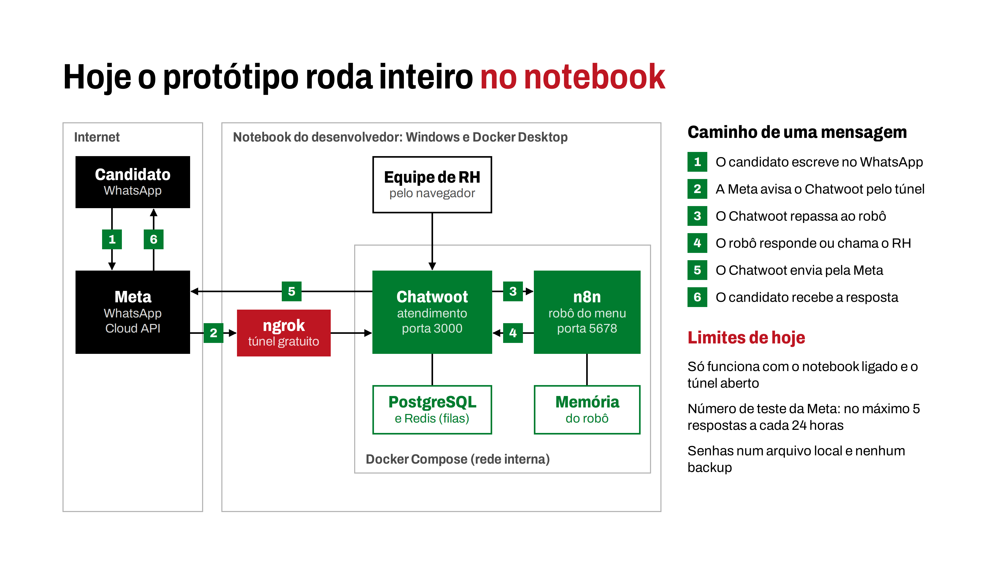
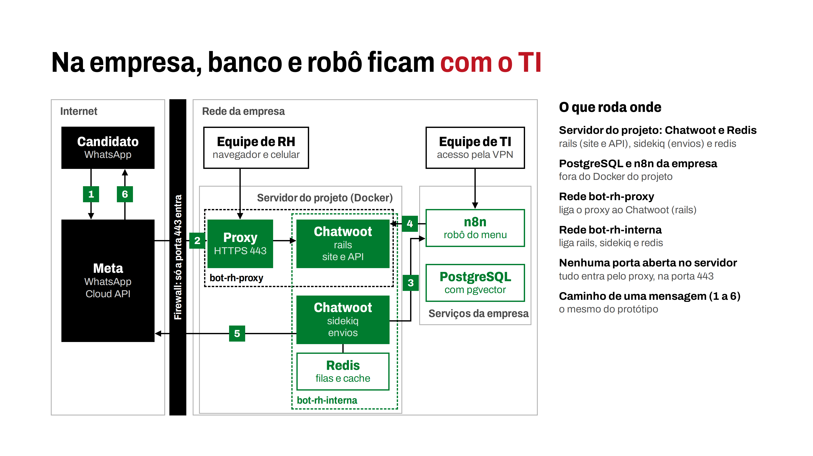
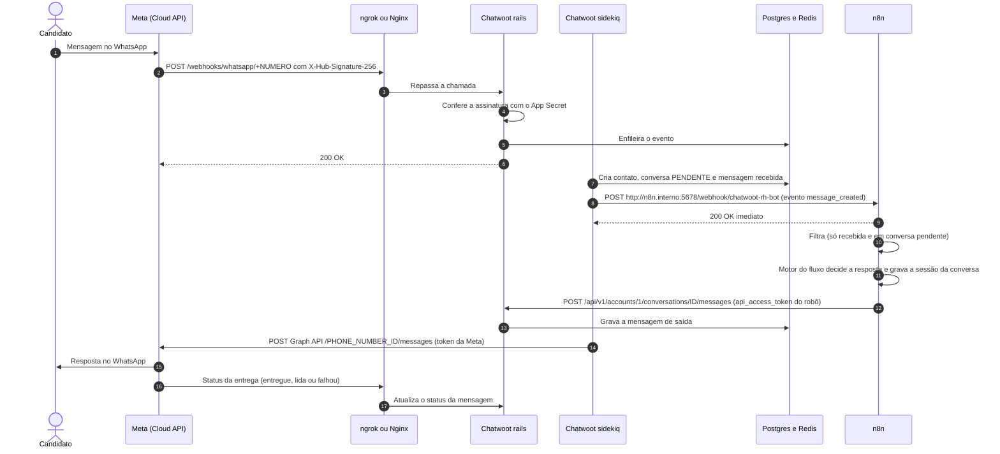
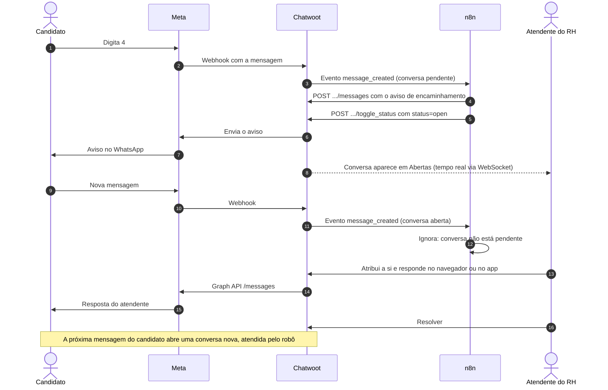
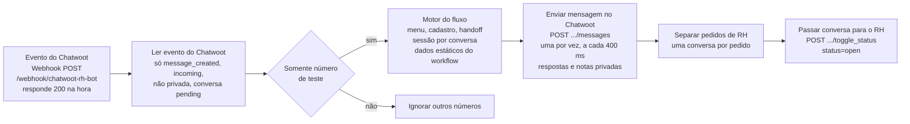

# Diagrama: arquitetura técnica da aplicação

Mostra os componentes, por onde passa cada mensagem, como cada chamada é autenticada e onde os dados ficam. Primeiro a visão geral em imagem (protótipo local e empresa), depois os detalhes técnicos.

> As seções 3 a 5 usam **Mermaid**. Elas aparecem desenhadas no GitHub, no VS Code com a extensão "Markdown Preview Mermaid Support" ou colando o bloco em https://mermaid.live.

---

## 1. Protótipo local, hoje

Detalhes que não aparecem na imagem:
- O Chatwoot tem dois serviços: `rails` (site e API, porta 3000 só em `127.0.0.1`) e `sidekiq` (filas, envio à Meta e eventos do robô).
- O n8n atende o Chatwoot pelo apelido `n8n.interno`, na rede do Docker. A porta 5678 fica só em `127.0.0.1`.
- O túnel é o ngrok gratuito, com domínio fixo `*.ngrok-free.dev`.

## 2. Na empresa

Detalhes que não aparecem na imagem:
- O proxy da empresa entra na rede Docker `bot-rh-proxy` e repassa HTTPS e WebSocket (`/cable`) para `http://bot-rh-chatwoot:3000`. A rede `bot-rh-interna` liga rails e sidekiq.
- O Redis roda no compose do projeto, só na rede `bot-rh-interna`. PostgreSQL e n8n são serviços da empresa (ver `deploy/README.md`).
- Quem chama a Meta e o n8n é o `sidekiq`. Quem recebe a Meta, o n8n e o RH é o `rails`, pelo proxy.
- As notificações do app de celular passam pelo servidor de repasse da Chatwoot (`hub.2.chatwoot.com`).
- O backup do projeto cobre os volumes de anexos (`storage_data`) e do Redis (`redis_data`) e os segredos. O banco fica na rotina do DBA da empresa.

As fontes das imagens ficam em `diagramas/fonte/` (HTML) e podem ser editadas.

## 3. Fluxo de uma mensagem com resposta do robô

## 4. Fluxo da passagem para o RH (opções 3 e 4)

## 5. Workflow do n8n

## 6. Chamadas, portas e autenticação

| De | Para | Endereço | Autenticação |
|---|---|---|---|
| Meta | Chatwoot | `POST {FRONTEND_URL}/webhooks/whatsapp/{número}` | Assinatura `X-Hub-Signature-256` (HMAC com o App Secret) |
| Meta | Chatwoot (verificação) | `GET {FRONTEND_URL}/webhooks/whatsapp/{número}?hub.verify_token=...` | Token de verificação da caixa |
| Chatwoot | Meta | `POST graph.facebook.com/.../{phone_number_id}/messages` | Token de acesso da Meta (Bearer) |
| Chatwoot | n8n | `POST http://n8n.interno:5678/webhook/chatwoot-rh-bot` | Rede interna. O Chatwoot envia `X-Chatwoot-Signature` (hoje não validada no n8n) |
| n8n | Chatwoot | `POST http://rails:3000/api/v1/accounts/{conta}/conversations/{id}/messages` e `.../toggle_status` | Header `api_access_token` com o token do Agent Bot |
| RH | Chatwoot | `https://{domínio}` (protótipo: `http://localhost:3000`) | Usuário e senha do Chatwoot |
| TI | n8n | `http://localhost:5678` (empresa: rede interna, VPN ou túnel SSH) | Usuário e senha do n8n |

| Serviço | Porta | Exposição |
|---|---|---|
| Chatwoot (`rails`) | 3000 | Só `127.0.0.1`. Público apenas via túnel (protótipo) ou Nginx (empresa) |
| n8n | 5678 | Só `127.0.0.1` e rede Docker |
| PostgreSQL | 5432 | Só rede Docker |
| Redis | 6379 | Só rede Docker |
| Painel do ngrok | 4040 | Só `127.0.0.1` (protótipo) |

## 7. Onde os dados ficam

| Local | Conteúdo |
|---|---|
| Volume `postgres_data` (PostgreSQL do Chatwoot) | Contatos, conversas, mensagens, notas privadas, usuários, configuração da caixa (inclui token da Meta e App Secret), Agent Bot |
| Volume `storage_data` (Chatwoot) | Anexos recebidos e enviados, como currículos |
| Volume `redis_data` | Filas de tarefas e cache (dados temporários) |
| Volume `n8n_data` (SQLite do n8n) | Workflow, credenciais criptografadas (token do Agent Bot), histórico de execuções, sessões das conversas e últimos 500 registros de cadastros e acompanhamentos |
| Arquivo `.env` | Segredos da instalação: chaves do Chatwoot e do n8n, senhas do Postgres e do Redis, PIN do número |
| Meta | As mensagens passam pelos servidores da Meta |

## 8. Variáveis que fazem a integração funcionar

| Variável ou ajuste | Onde | Por quê |
|---|---|---|
| `FRONTEND_URL` | `.env` do Chatwoot | Base do endereço de webhook que o Chatwoot registra na Meta |
| `SAFE_FETCH_ALLOW_PRIVATE_NETWORK=true` | `.env` do Chatwoot | Sem ela, o Chatwoot bloqueia o webhook do Agent Bot para o n8n, que está em IP privado |
| Apelido de rede `n8n.interno` | `docker-compose.yml` | O formulário de robô do Chatwoot só aceita URL com ponto no nome do host |
| `N8N_ENCRYPTION_KEY` | `.env` do n8n | Criptografa as credenciais salvas no n8n |
| `N8N_DIAGNOSTICS_ENABLED=false` e similares | `docker-compose.yml` | Impedem o n8n de enviar dados aos servidores do n8n |
| `CHATWOOT_URL = 'http://rails:3000'` | Nó "Motor do fluxo" | Endereço interno da API do Chatwoot usado pelo robô |
