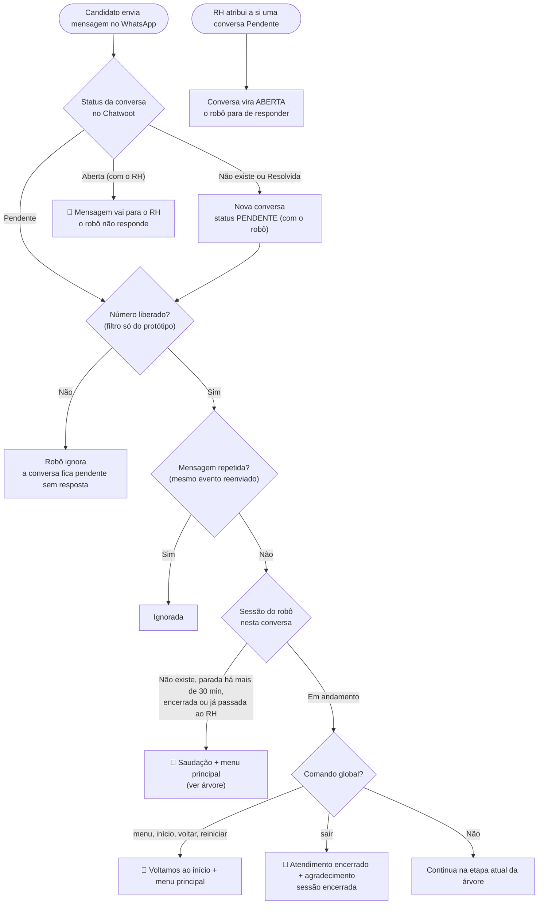
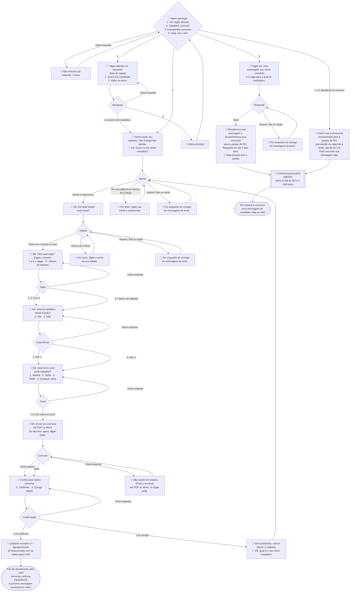

# Diagrama: roteiro do chatbot (árvore de decisões)

Mostra todas as escolhas do candidato e a resposta do robô para cada uma, conforme o workflow "Chatbot RH via Chatwoot (protótipo)" (nó **Motor do fluxo**).

> Os diagramas usam **Mermaid**. Eles aparecem desenhados no GitHub, no VS Code com a extensão "Markdown Preview Mermaid Support" ou colando o bloco em https://mermaid.live.

Legenda: 🤖 = mensagem do robô · 📋/🔎 = nota privada para o RH · 👤 = atendimento humano.

---

## 1. Quem responde a mensagem

Antes da árvore do menu, o Chatwoot e o robô decidem **se** o robô deve responder.

## 2. Árvore do menu (todas as saídas)

## 3. Mensagens do robô (textos atuais)

Os textos com **[ajustar]** são exemplos do protótipo e podem ser trocados no bloco CONFIGURAÇÃO do nó **Motor do fluxo**.

| Momento | Mensagem |
|---|---|
| Saudação (sessão nova) | Olá, *primeiro nome*! 👋 Você está no atendimento de Recrutamento e Seleção da Fazenda Nova Piratininga. Como podemos ajudar? Digite o número da opção: 1. Ver vagas abertas · 2. Cadastrar currículo · 3. Acompanhar processo · 4. Falar com o RH |
| Resposta inválida no menu | Não entendi sua resposta. + menu |
| Comando "menu" | Voltamos ao início. + menu |
| Comando "sair" | Atendimento encerrado. + agradecimento final |
| Opção 1 | Vagas abertas no momento: Trabalhador rural (Plantio, trato e colheita), Tratorista (CNH categoria C ou superior), Operador de máquinas (Experiência mínima de 1 ano), Auxiliar administrativo (Ensino médio completo) **[ajustar]**. Digite: 1. Quero me candidatar · 2. Voltar ao menu |
| Início do cadastro | Vamos fazer seu cadastro. São 6 perguntas rápidas. A qualquer momento, digite *menu* para voltar ao início ou *sair* para encerrar. |
| 1/6 | Qual é o seu nome completo? |
| 2/6 | Em qual cidade você mora? |
| 3/6 | Para qual vaga você quer se candidatar? Digite o número: (vagas numeradas) · 5. Banco de talentos (nenhuma das vagas) |
| 4/6 | Você já trabalhou nessa função? Digite: 1. Sim · 2. Não |
| 5/6 | Qual turno você pode trabalhar? Digite o número: 1. Manhã · 2. Tarde · 3. Noite · 4. Qualquer turno |
| 6/6 | Envie seu currículo em PDF ou Word por aqui. Se não tiver agora, digite *pular*. |
| Resumo | Confira seus dados: Nome, Cidade, Vaga, Experiência na função, Turno, Currículo. Está tudo certo? Digite: 1. Confirmar · 2. Corrigir dados |
| Cadastro confirmado | Cadastro enviado, *primeiro nome*! ✅ Se o seu perfil combinar com a vaga, o RH vai entrar em contato por este WhatsApp. + agradecimento final |
| Agradecimento final | Obrigado pelo contato com o Recrutamento e Seleção da Fazenda Nova Piratininga! 😊 Quando quiser falar de novo, é só mandar uma mensagem. |
| Opção 3 | Para consultar seu processo, digite em uma mensagem seu *nome completo* e a *vaga* para a qual você se candidatou. |
| Opção 3 concluída | Recebemos sua mensagem e encaminhamos sua conversa para a equipe de RH, que atende de segunda a sexta, das 8h às 17h **[ajustar]**. A resposta vem por aqui em até 2 dias úteis **[ajustar]**. |
| Opção 4 | Certo! Sua conversa foi encaminhada para a equipe de RH, que atende de segunda a sexta, das 8h às 17h **[ajustar]**. Pode escrever sua mensagem aqui. Uma pessoa do RH vai responder por esta conversa. |
| Só texto | Por enquanto só consigo ler mensagens de texto. Por favor, digite sua resposta. |

## 4. Notas privadas para o RH

| Quando | Conteúdo | Status da conversa |
|---|---|---|
| Cadastro confirmado | 📋 Cadastro recebido pelo bot: nome, cidade, vaga, experiência, turno, currículo (com link do arquivo, se enviado) | Continua **Pendente** |
| Opção 3 concluída | 🔎 Pedido de acompanhamento de processo: o texto enviado pelo candidato | Passa para **Aberta** |

## 5. Regras de sessão

| Regra | Efeito |
|---|---|
| 30 minutos sem resposta do candidato | A próxima mensagem recomeça com a saudação e o menu |
| Cadastro confirmado ou "sair" | Sessão encerrada: a próxima mensagem recomeça com a saudação |
| Opção 3 concluída ou opção 4 | A conversa vai para o RH. Se ela voltar a ficar com o robô, ele recomeça com a saudação |
| Conversa resolvida pelo RH | A próxima mensagem do candidato abre uma conversa nova, atendida pelo robô |
| Acentos e maiúsculas | Ignorados: "Não", "nao" e "NÃO" valem o mesmo |
